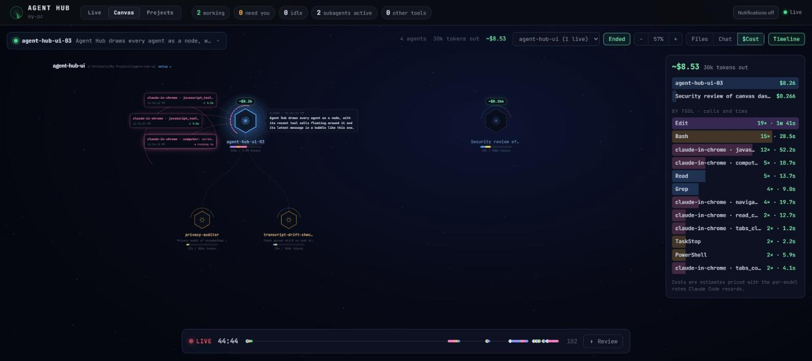

# Agent Hub

[](https://www.npmjs.com/package/agent-hub-ui)
[](https://github.com/UurDemir/agent-hub-ui/actions/workflows/ci.yml)
[](LICENSE)

A local web dashboard that shows every coding agent running on this PC and what each one is doing, live.



## Run it

No clone needed. With Node 20 or newer:

```
npx agent-hub-ui                      # from npm
npx github:UurDemir/agent-hub-ui      # or straight from GitHub
```

It starts on http://127.0.0.1:4317 and opens your browser. Stop it with Ctrl+C.

| Option | |
|---|---|
| `--port <port>` | Use another port (default 4317) |
| `--no-open` | Don't open the browser |
| `--host <host>` | Address to bind (default `127.0.0.1`; keep it local, transcripts contain your code. Any other address needs `--viewer-password`) |
| `--allow-send` | Let the dashboard send messages to running Claude Code sessions (see [Messaging sessions](#messaging-sessions)) |

To keep it around, install it globally with `npm install -g agent-hub-ui` and run `agent-hub`.

From a clone, use `npm start` (or `npm run open` to also open the browser). There are no dependencies, so there's nothing to `npm install`.

## What it shows

- **Live activity**: one swimlane per agent and subagent. Each tool call is a bar colored by type (read, edit, shell, web, subagent, MCP…), sized by how long it took. Failed calls get a red marker. Your messages show as white lines and agent replies as dots. Hover a bar for details and click a lane to follow that agent. You can switch the window between 2 minutes and 2 hours.
- **Agent cards**: status (working / needs you / idle / ended), project and branch, what the agent is doing right now with a running timer, active subagents, model, context size, output tokens and tool count.
- **Detail panel**: the full timeline of prompts, replies and tool calls. Click a tool call to see its input and output. The panel also shows the agent's plan (TodoWrite), background-job tasks, subagents, PR links, and the files it changed: click a file for each edit's diff.
- **Canvas** (`#/canvas`): a live map of your agents as a node graph. Each agent is a hexagon with its estimated cost, context usage and a ring of its recent tool types; subagents hang off their parent with particles flowing while they work. Recent tool calls float around each agent (click one for its input and output) and Claude's latest message shows as a bubble. Ended sessions and finished subagents fade out about a minute and a half after their last activity, like finished tool calls (turn on **Ended** to keep them). Side panels show cost per agent and per tool, the selected agent's conversation, and the files being read and changed. The timeline at the bottom shows every event: click or drag it to see the map at an earlier moment, or press Review to replay. Pick a single project with the selector (`#/canvas/<project>`), drag to pan, scroll to zoom.
- **OpenAI Codex CLI**: Codex sessions get the same live view as Claude Code: prompts, replies, tool calls (shell commands, patches, MCP calls, plan updates) with their results, project, branch, model, context and output tokens, working or idle, and spawned subagents. They're read from Codex's own session files (`~/.codex/sessions`, or `$CODEX_HOME`). Codex's reasoning, including its summaries, is never shown. Cost isn't shown for Codex.
- **OpenClaw**: sessions of the OpenClaw assistant gateway, with their messages, tool calls and results, model, tokens and cost (as OpenClaw records it), and subagents. Run Agent Hub (or its reporter) on the machine the OpenClaw gateway runs on. Current OpenClaw keeps sessions in SQLite, which needs Node 22.13 or newer (compressed entries need 22.15); on an older Node, OpenClaw only shows up as a process. Thinking is never shown, and secrets in tool arguments (an `exec` command's `env`, headers, tokens) are dropped before anything leaves the collector.
- **Gemini CLI**: sessions from Gemini CLI's chat recordings (`~/.gemini/tmp/<project>/chats/`, or under `$GEMINI_CLI_HOME`), with prompts, replies, tool calls and results, tokens, plans and subagents. Thoughts are never shown.
- **GitHub Copilot CLI**: sessions from `~/.copilot/session-state/` (or `$COPILOT_HOME`), with prompts, replies, tool calls and results, plans and permission prompts (shown as "needs you"). Reasoning is never shown.
- **opencode**: sessions from opencode's database (`~/.local/share/opencode/opencode.db`, or under `$XDG_DATA_HOME`, or `$OPENCODE_DB`), with prompts, replies, tool calls and results, tokens, cost, plans and subagent sessions. It needs Node 22.13 or newer (SQLite); on an older Node, opencode only shows up as a process. Reasoning is never shown.
- **Other AI tools**: Cursor, Windsurf, and Codex, OpenClaw, Gemini CLI, Copilot CLI and opencode while none of their sessions is shown above, Aider, Goose, Claude Desktop, Ollama and LM Studio are detected from the process list. For these it shows presence, process count, memory and uptime.
- **Projects page** (`#/projects`): every folder you've used Claude Code in, plus your global `~/.claude` setup. Each project has tabs for:
  - CLAUDE.md files and rules
  - agents, skills and slash commands, each with a usage count taken from the project's transcripts
  - MCP servers, hooks and permissions
  - auto-memory and sessions
  - plugins (global setup only)

  Credentials in MCP commands, env vars and headers are hidden. The API only reads paths of projects Claude Code already knows about.
- **History** (`#/history`): past sessions, grouped by day, with full-text search over your prompts and replies. Open one to read its timeline and the files it changed. On a hub it also lists the ended sessions machines reported, with what each machine shared. This PC's own transcripts are only listed for someone viewing on this PC.
- **Usage** (`#/usage`): tokens and estimated cost per day, project and model over the last 7, 30 or 90 days, from your Claude Code transcripts (costs use the per-model rates Claude Code records). On a hub, also tokens and cost per reporting machine.
- **Messaging** (optional, `--allow-send`): a message box in the detail panel and in the Canvas chat panel sends text to a running session. See below.
- **Notifications** (optional): a desktop notification when an agent finishes or needs your input while the tab is in the background, or push notifications to your phone or a chat without any tab open (`--notify`, see below).

## Many machines on one dashboard (optional)

By default nothing leaves your PC. To watch agents on several machines in one place, for yourself or for a team, run one Agent Hub as a **hub** and have the other machines **report** to it.

**1. Create a key per machine** (on any machine):

```
npx agent-hub-ui --new-key alice-laptop
```

This prints a key for that machine and a keys-file entry for the hub. The keys file only stores a hash of each key:

```json
{ "machines": [
  { "name": "alice-laptop", "sha256": "…" },
  { "name": "build-box", "sha256": "…", "share": "metadata" }
] }
```

`share` (optional) caps what the hub keeps from that machine, whatever the machine sends. The hub re-reads the file when it changes, so deleting an entry revokes that machine without a restart.

**2. Start the hub:**

```
npx agent-hub-ui --hub --hub-keys keys.json --tls-cert cert.pem --tls-key key.pem
```

Reporters send to its ingest port (4318, all interfaces). That port only accepts reports signed with a known key; it serves no data. The dashboard stays on `127.0.0.1:4317` as usual. Without `--tls-cert`, put the ingest port behind a TLS proxy or use it only on an encrypted network (VPN, Tailscale, WireGuard).

**3. Report from each machine:**

```
AGENT_HUB_REPORT_KEY=ahk_… npx agent-hub-ui --report-to https://hub.example.com:4318 --share metadata
```

Add `--headless` to report without opening the local dashboard, for example as a background service (see [Run it in the background](#run-it-in-the-background)). `--report-key-file <file>` reads the key from a file instead. Use a self-signed hub certificate by pointing `NODE_EXTRA_CA_CERTS` at it. The reporter refuses a plain `http://` hub that isn't on the same machine unless you pass `--allow-http`.

**What leaves the machine** is set on the machine itself with `--share`, and the hub can only lower it:

| Level | Sends |
|---|---|
| `metadata` (default) | status, project folder name, model, tokens, cost, tool names and timings |
| `activity` | adds session titles, branches, plans (TodoWrite), subagent task descriptions, PR links and one-line tool summaries |
| `full` | adds prompts, replies, tool input and output, and full paths |

The reporting machine's own dashboard shows a "Reporting to … · level" badge at the top while it reports, and the terminal prints the same. Sending can't be turned on from the hub. If you monitor other people's machines, tell them and choose the lowest level that does the job; employee-monitoring rules (GDPR, works councils, KVKK and others) may apply.

**Showing the hub to others.** The hub dashboard has every reporting machine's activity, so it won't listen beyond `127.0.0.1` without a login. The recommended setup is your company SSO in front of it: a reverse proxy (oauth2-proxy, Cloudflare Access, nginx with SSO…) on the hub machine forwards to `127.0.0.1:4317`. Pass the public host name with `--allowed-host hub.example.com` (add `:port` if the browser's address has one) so the dashboard accepts it. Viewers coming through that name, or over the network, see the agents but not the hub PC's own Projects page. If you don't have SSO, `--viewer-password` (or `$AGENT_HUB_VIEWER_PASSWORD`) adds a simple password prompt; use it only over TLS or a VPN.

The hub keeps everything in memory: the last 200 events per session, like a normal dashboard. A machine that stops reporting shows as disconnected after 20 seconds and is dropped after 3 hours. The Projects page still shows only the hub machine's own projects.

| Hub options | |
|---|---|
| `--hub` | Accept reports from the machines in the keys file |
| `--hub-keys <file>` | The keys file (required with `--hub`) |
| `--ingest-port <port>` / `--ingest-host <host>` | Where reporters connect (default `0.0.0.0:4318`) |
| `--tls-cert <file>` / `--tls-key <file>` | Serve the ingest port over HTTPS |
| `--allowed-host <host>` | Accept this `Host` header, e.g. your proxy's public name (repeatable) |
| `--viewer-password <p>` | Require this password for the dashboard |
| `--viewer-password-file <file>` | The same, read from a file |

| Reporter options | |
|---|---|
| `--report-to <url>` | The hub's ingest URL |
| `--report-key-file <file>` | File holding this machine's key (or `$AGENT_HUB_REPORT_KEY`) |
| `--share <level>` | `metadata` (default), `activity` or `full` |
| `--headless` | Don't serve the local dashboard |
| `--allow-http` | Allow a plain-http hub on another machine |

### Running the hub in a container (NAS, home server)

Each release is also published as a container image, `ghcr.io/uurdemir/agent-hub-ui`, for running the hub on a NAS or server. A container can't see the host's Claude Code sessions, so it's only useful as a hub. Configure it with environment variables. `AGENT_HUB_MACHINES` takes the keys file's JSON directly, so no file has to be mounted:

```yaml
services:
  agent-hub:
    image: ghcr.io/uurdemir/agent-hub-ui:latest
    environment:
      AGENT_HUB_HUB: "1"
      AGENT_HUB_VIEWER_PASSWORD: "pick-a-password"
      AGENT_HUB_MACHINES: '{"machines":[{"name":"my-pc","sha256":"…from --new-key…"}]}'
    ports:
      - "4317:4317"   # dashboard
      - "4318:4318"   # ingest
    restart: unless-stopped
```

To keep the hub's machines, sessions and History across restarts and upgrades, mount a volume on `/data` (the image sets `AGENT_HUB_DATA_DIR=/data`; ended sessions are kept for `AGENT_HUB_RETAIN_DAYS`, default 7). The image has a health check (`/healthz`, which answers without the viewer password and carries no session data). Add `AGENT_HUB_NOTIFY` for push notifications and `AGENT_HUB_METRICS: "1"` for Prometheus metrics (see below).

The machine list marks a reporter that runs a version older than the hub needs with **update**: older reporters can't let the hub keep prompt text out of names and tool summaries when the keys file lowers their sharing level.

Machines in `AGENT_HUB_MACHINES` are read at startup, so revoking one means editing the variable and restarting the container (a mounted keys file with `AGENT_HUB_KEYS` is re-read on change instead). The image is only meant as a hub: don't mount a `~/.claude` into it. To serve the ingest port over HTTPS, mount a certificate and set `AGENT_HUB_TLS_CERT` and `AGENT_HUB_TLS_KEY`. Without one, machines report with `--allow-http`, so do that only on a network you trust or over a VPN.

### Run it in the background

`--install-service` sets up a per-user service that runs Agent Hub with the other options on the same command line (plus `--no-open`). It starts when you log in and restarts after a failure. This works for a reporter, a hub or a plain local dashboard. Install the package first (`npm i -g agent-hub-ui`): the service runs the installed copy by its full path, and a copy in npx's cache can be cleaned up.

```
# Windows: scheduled task "Agent Hub", started hidden at logon
agent-hub --install-service --report-to https://nas:4318 --report-key-file C:\Users\me\.agent-hub-key --headless

# macOS: LaunchAgent ~/Library/LaunchAgents/ui.agent-hub.plist
agent-hub --install-service --report-to https://nas:4318 --report-key-file ~/.agent-hub-key --headless

# Linux: systemd user unit ~/.config/systemd/user/agent-hub.service
agent-hub --install-service --report-to https://nas:4318 --report-key-file ~/.agent-hub-key --headless
loginctl enable-linger $USER   # optional: keep it running while you're logged out
```

- `--print-service` shows the files and commands without changing anything.
- `--service-status` shows whether it's installed and running.
- `--uninstall-service` stops it and removes it.
- Logs go to `%LOCALAPPDATA%\agent-hub\agent-hub.log` on Windows, `~/Library/Logs/agent-hub.log` on macOS, and the journal on Linux (`journalctl --user -u agent-hub -f`).

Secrets aren't written into the service definition. Give the machine key with `--report-key-file` and the viewer password with `--viewer-password-file`; `--viewer-password`, `$AGENT_HUB_REPORT_KEY` and `$AGENT_HUB_VIEWER_PASSWORD` are refused. Relative paths are made absolute. The service keeps a few non-secret variables from the shell you install it from, such as `CLAUDE_CONFIG_DIR` and `NODE_EXTRA_CA_CERTS`. If you upgrade or move Node.js or Agent Hub, run `--install-service` again.

## Push notifications (optional)

`--notify <target>` (repeatable, or `$AGENT_HUB_NOTIFY`, separated by spaces or commas) sends a notification when an agent needs you or finishes a turn that took at least 30 seconds, on this PC or, on a hub, on any reporting machine. No dashboard tab has to be open. Targets:

| Target | Example |
|---|---|
| ntfy | `ntfy:https://ntfy.sh/my-agents` (`https://user:pass@…` for a protected topic) |
| Gotify | `gotify:https://gotify.example/message?token=APP_TOKEN` |
| Discord | `discord:https://discord.com/api/webhooks/…` |
| Slack | `slack:https://hooks.slack.com/services/…` |
| Telegram | `telegram:<bot token>/<chat id>` |
| Any webhook | `webhook:https://example/hook` (JSON `{ event, title, body, agent, t }`) |

Targets carry tokens, so for a background service put them in a file, one per line: `--notify-file <file>` (`$AGENT_HUB_NOTIFY_FILE`). What a notification says follows its own sharing level, `--notify-share` (default `metadata`: an agent is named after its project folder and nothing it wrote is included; `activity` adds the tool it's running; `full` adds its last reply). `--notify-on` picks the events: `waiting`, `done` (the default is both) and `machine` (a reporting machine disconnects or comes back). `--notify-min-seconds` changes the 30 seconds. Notifications are rate limited per agent and overall.

## Metrics and health (optional)

`--metrics` (`AGENT_HUB_METRICS=1`) serves Prometheus metrics at `/metrics` on the dashboard port, behind the same Host check and viewer password: agents by machine, tool and status, working subagents, output and context tokens, estimated cost, tool calls, other AI tools' processes, and on a hub each machine's online state, last report and whether it needs an update. Only counts and the labels machine, tool, status and model; no names, paths or text. `/healthz` answers `{"ok":true}` for health checks.

## How it works

`server/` reads Claude Code's, Codex's and OpenClaw's local state and streams it to the page over Server-Sent Events:

| Source | Used for |
|---|---|
| `~/.claude/sessions/<pid>.json` | which sessions are running, and whether each is busy or idle |
| `~/.claude/projects/<project>/<session>.jsonl` | the transcript, tailed incrementally |
| `…/<session>/subagents/agent-*.jsonl` | subagent transcripts and metadata |
| `~/.claude/jobs/<id>/state.json` | background-job state and its running shell tasks |
| `~/.codex/sessions/YYYY/MM/DD/rollout-*.jsonl` | Codex session transcripts, tailed incrementally |
| `~/.codex/thread-writer-locks/<id>.lock` | which Codex sessions are open |
| `~/.codex/session_index.jsonl` | names you gave Codex sessions |
| `~/.openclaw/agents/<agent>/agent/openclaw-agent.sqlite` | OpenClaw sessions and transcripts, opened read-only |
| `~/.openclaw/agents/<agent>/sessions/` | the same for OpenClaw up to 2026.7 (`sessions.json` and JSONL transcripts) |
| `~/.openclaw/tmp/openclaw*/gateway.*.lock` | whether the OpenClaw gateway is running (its heartbeat) |
| `~/.gemini/tmp/<project>/chats/*.jsonl` | Gemini CLI chat recordings, tailed incrementally |
| `~/.copilot/session-state/<id>/events.jsonl`, `workspace.yaml`, `inuse.<pid>.lock` | Copilot CLI sessions, their names and which are open |
| `~/.local/share/opencode/opencode*.db` | opencode sessions, messages and tool parts, opened read-only |

It reads only these files, never writes them, and never touches your Claude login credentials. The one thing it writes is a hub's own state file, and only with `--data-dir`. With `--allow-send` it also reads each session's messaging key (`~/.claude/sessions/<pid>.<hash>.key`) to send messages. The server listens on `127.0.0.1` only, because transcripts contain your code and prompts. Nothing is sent anywhere unless you start it with `--report-to` (see above). Set `PORT` to change the port. Set `CLAUDE_CONFIG_DIR` if your Claude config lives somewhere else, `CODEX_HOME` for Codex's, `OPENCLAW_STATE_DIR` for OpenClaw's (`OPENCLAW_PROFILE` and `OPENCLAW_HOME` work as they do in OpenClaw), `GEMINI_CLI_HOME` for Gemini CLI's, `COPILOT_HOME` for Copilot CLI's, and `XDG_DATA_HOME` or `OPENCODE_DB` for opencode's.

To add another agent that keeps local logs, write a collector like `server/claude.js`, `server/codex.js`, `server/openclaw.js`, `server/gemini.js`, `server/copilot.js` or `server/opencode.js` that emits the same event shape (`prompt`, `say`, `tool`, `result`), and add it to the `Sources` list in `server/index.js`.

## Messaging sessions

Start with `--allow-send` (`npx agent-hub-ui --allow-send`, or `npm start -- --allow-send` from a clone). Running Claude Code sessions then get a message box in the Live view's detail panel and under the conversation in the Canvas **Chat** panel. Enter sends, Shift+Enter adds a new line.

Only browser tabs you unlock can send:

- The tab Agent Hub opens at startup is unlocked. It keeps working after a reload, until the server restarts.
- Any other tab shows a note instead of the box. To unlock one, open the one-use link Agent Hub printed in its terminal (`…/#send=<code>`), either in a new tab or pasted into the open one.
- Each time a link is used, the terminal prints a fresh one for the next tab.
- With `--no-open`, or `npm start`, nothing is opened; the first link is printed instead.

Messages go through the local messaging socket Claude Code opens for each session, the same channel Claude sessions use to message each other. The session gets your text as a message from another session, not as if you had typed it in its terminal. It's queued until the current turn ends. The agent can act on it with whatever tools that session is already allowed to use, so treat it like typing a prompt into that session. Sent messages show in the timeline as **YOU · HUB**, and messages from other sessions as **SESSION**. The label comes from the sender's self-reported name, so another session could also claim to be the hub.

This is off by default because it lets the dashboard start work in your agents. When it's on, each unlocked tab gets its own random token, and every send must include it and come from the dashboard's own origin. No API call hands a token to anything that doesn't hold an unlock code. Codes live only in the URL fragment, which browsers never send to a server, and in the terminal. Other websites can't read a token or send with one, and the dashboard can't be embedded in another site.

The unlock link that opens at startup is briefly visible in the browser-launch command line, and it ends up in your browser history. Another program on your machine that catches it before your tab uses it could unlock itself instead. Your tab would then show the "already used" error, so you'd notice. Still, only use `--allow-send` on a machine where you trust the local users and programs. `--allow-send` is ignored unless the server listens on a loopback address. The socket protocol isn't documented by Anthropic, so a Claude Code update can break it. If that happens, the message box shows the error.

## Acknowledgements

The Canvas view's design is based on [agent-flow](https://github.com/patoles/agent-flow) by Simon Patole ([@patoles](https://github.com/patoles)).

## License

[MIT](LICENSE) © Uğur Demir
